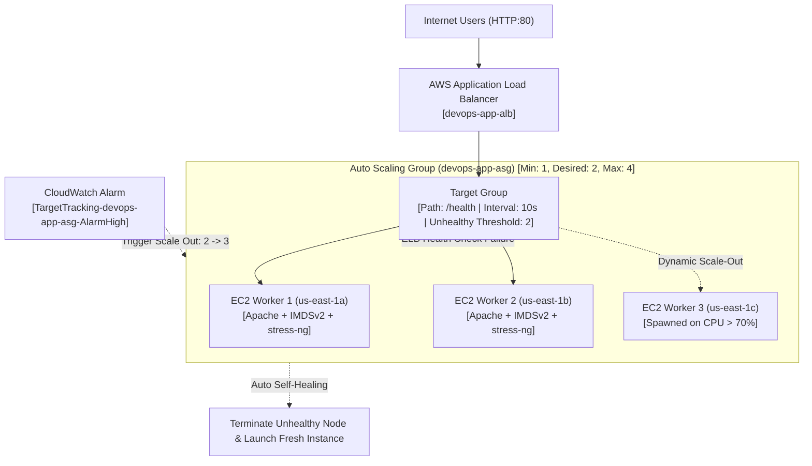

# High-Availability Auto Scaling Group & Application Load Balancer


**Candidate:** Ankit Gawade  
**Role:** DevOps Engineer  
**Evaluating Organization:** Itvedant Education Pvt. Ltd.  
**Repository:** [https://github.com/gawadeAnkit/aws-asg-alb-scaling](https://github.com/gawadeAnkit/aws-asg-alb-scaling)  
**Live Endpoint:** `http://devops-app-alb-890029008.us-east-1.elb.amazonaws.com`

---

## 1. Architecture Overview

This project provisions a resilient, self-healing, multi-AZ cloud architecture on AWS using **Terraform (IaC)**. The cluster is fronted by an internet-facing **Application Load Balancer (ALB)**, dynamically balancing HTTP traffic across an **Auto Scaling Group (ASG)** spanning three Availability Zones (`us-east-1a`, `us-east-1b`, and `us-east-1c`).



---

## 2. Assessment Requirements & Production Standards

| Requirement | Implementation Details | DevOps Standard |
|---|---|---|
| **Launch Template** | Amazon Linux 2023 (`t3.micro`), IMDSv2 enforced (`http_tokens = "required"`), detailed 1-minute CloudWatch monitoring enabled. | **Zero Static SSH Keys:** Passwordless management via AWS Systems Manager (SSM) IAM profile (`AmazonSSMManagedInstanceCore`). |
| **Security Group Isolation** | ALB SG accepts inbound HTTP (port 80) from `0.0.0.0/0`. EC2 SG accepts HTTP **strictly from the ALB Security Group**. | **Zero-Trust Network:** Direct internet access to EC2 worker nodes is completely blocked. |
| **Application Load Balancer** | Public ALB distributed across 3 AZs (`us-east-1a`, `us-east-1b`, `us-east-1c`). Port 80 listener forwards to Target Group. | **High Availability:** Eliminates single point of failure (SPOF) with Multi-AZ redundancy. |
| **Target Group Health Checks** | Fast-detecting health check against `/health`: `interval = 10s`, `timeout = 5s`, `healthy_threshold = 2`, `unhealthy_threshold = 2`. `deregistration_delay = 15s`. | **Rapid Fault Isolation:** Detects failing web processes within 20 seconds. |
| **Auto Scaling Group** | `min_size = 1`, `desired_capacity = 2`, `max_size = 4`. Health check type set explicitly to **`ELB`** with 90s grace period. | **Automated Healing:** ASG terminates instances failing ALB HTTP health checks (not just EC2 hypervisor checks). |
| **70% CPU Target Tracking** | `aws_autoscaling_policy` with `policy_type = "TargetTrackingScaling"` tracking metric `ASGAverageCPUUtilization` at target value `70.0`. | **Elastic Scaling:** Scales out instances automatically when aggregate CPU spikes above 70%. |

---

## 3. Practical Demonstrations & Verification Proof

### Proof 1: Automatic Replacement of Unhealthy Instances (Self-Healing)
1. **Trigger:** Stopped Apache (`systemctl stop httpd`) on healthy instance `i-08c4104b8d3ccffdb` via AWS SSM.
2. **Detection:** ALB Target Group evaluated consecutive failed health checks on `/health` and marked the target **`unhealthy`** (`Target.FailedHealthChecks`).
3. **Healing Action:** ASG (`health_check_type = "ELB"`) drained active connections, terminated `i-08c4104b8d3ccffdb`, and launched fresh replacement instance `i-0cd59e5ed9537e7ef`.
4. **AWS Scaling Activity Log:**
   ```json
   {
     "Description": "Launching a new EC2 instance: i-0cd59e5ed9537e7ef",
     "Cause": "At 2026-11-13T02:24:37Z an instance was launched in response to an unhealthy instance needing to be replaced.",
     "StatusCode": "Successful"
   }
   ```

### Proof 2: Dynamic Scale-Out on CPU > 70% (Target Tracking)
1. **Trigger:** Executed CPU load generation using `stress-ng --cpu 2 --timeout 300s` via AWS SSM across running cluster nodes.
2. **Metric Spike:** CloudWatch metric `ASGAverageCPUUtilization` surged to **100.0%** (exceeding the 70.0% threshold).
3. **Alarm State:** CloudWatch Alarm `TargetTracking-devops-app-asg-AlarmHigh` entered **`ALARM`** state.
4. **Scaling Action:** ASG automatically scaled capacity from **2 $\rightarrow$ 3 instances**, launching `i-06f091be9df03c8a8` in `us-east-1b`.
5. **AWS Scaling Activity Log:**
   ```json
   {
     "Description": "Launching a new EC2 instance: i-06f091be9df03c8a8",
     "Cause": "At 2026-11-13T02:30:01Z a monitor alarm TargetTracking-devops-app-asg-AlarmHigh in state ALARM triggered policy cpu-utilization-target-70 changing the desired capacity from 2 to 3.",
     "StatusCode": "Successful"
   }
   ```

---

## 4. Multi-AZ Active Cluster Topology

| Instance ID | Availability Zone | Lifecycle State | Target Group Health | Workload Role |
|---|---|---|---|---|
| `i-0cd59e5ed9537e7ef` | `us-east-1a` | `InService` | `healthy` (HTTP 200) | Apache Web Worker (Auto-Healed) |
| `i-06f091be9df03c8a8` | `us-east-1b` | `InService` | `healthy` (HTTP 200) | Apache Web Worker (CPU Scale-Out) |
| `i-0a14d7fe4dfad89c1` | `us-east-1c` | `InService` | `healthy` (HTTP 200) | Apache Web Worker (Baseline Node) |

---

## 5. Evaluation Panel Runbook

```bash
# 1. Probe ALB Endpoint and verify round-robin HTTP 200
curl -I http://devops-app-alb-890029008.us-east-1.elb.amazonaws.com/health

# 2. Inspect Target Group Health across all registered instances
aws elbv2 describe-target-health \
  --target-group-arn "arn:aws:elasticloadbalancing:us-east-1:851706351853:targetgroup/devops-app-tg/1dabfbabe348fa69" \
  --query "TargetHealthDescriptions[].{Id:Target.Id,State:TargetHealth.State}" \
  --output table

# 3. Inspect Auto Scaling Group capacity and healthy instances
aws autoscaling describe-auto-scaling-groups \
  --auto-scaling-group-names devops-app-asg \
  --query "AutoScalingGroups[0].Instances[].{InstanceId:InstanceId,AZ:AvailabilityZone,HealthStatus:HealthStatus,LifecycleState:LifecycleState}" \
  --output table

# 4. Inspect CloudWatch 70% Target Tracking Scaling Alarms
aws cloudwatch describe-alarms \
  --alarm-name-prefix "TargetTracking-devops-app-asg" \
  --query "MetricAlarms[].{AlarmName:AlarmName,Threshold:Threshold,StateValue:StateValue}" \
  --output table

# 5. Inspect Historical Scaling Activities (Self-Healing & CPU Scaling Events)
aws autoscaling describe-scaling-activities \
  --auto-scaling-group-name devops-app-asg \
  --query "Activities[].{Description:Description,Cause:Cause,StartTime:StartTime}" \
  --output json
```

---

## 6. Author Sign-Off

- **DevOps Engineer:** Ankit Gawade
- **Email:** [ankitgawade1234@gmail.com](mailto:ankitgawade1234@gmail.com)
- **Target Organization:** Itvedant Education Pvt. Ltd.
- **Assessment Submission Document:** [DevOps_Engineer_Assessment_Submission_Ankit_Gawade.pdf](file:///C:/Interview_Tasks/DevOps_Engineer_Assessment_Submission_Ankit_Gawade.pdf)
